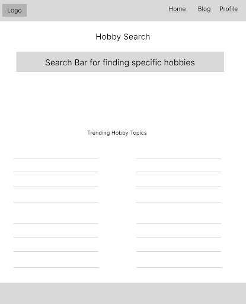

## Project Title
**Using a website as a means of connection for hobbyists looking for community (work in progress)**

## Objective
The client tasked me with solving a problem: individuals feeling disconnected from those around them. Hobbies are a popular pastime, and finding improvement within a hobby isn't always straightforward. Mentor Connection bridges Mentors with Mentees in their own hobbies.

## Synopsis
This project is similar to websites like superprof.com and findamentor.com, which primarily focus on professional careers or charge a fee for their services. Mentor Connection is designed for individuals who want to build relationships, connect with other users, and develop new skills together. I was inspired to create this because of my own experiences trying to find people who share my hobbies. This platform will help connect people like me so we can practice our hobbies together. 

## Process
At the moment, Mentor Connection is still a work in progress. The website’s HTML content, CSS styles, and color scheme are already established. I began development by deciding on a visual direction through a mood board and wireframes. Next, I wrote the copy and implemented the styling. Moving forward, I will continue to refine the content and build out the JavaScript and backend.

## Results
The work is expected to be concluded by December 4th, 2026. I will update this case study with the completed version information. I will display the final product on my portfolio website. 

## Project Photos

### Planning Process
- Moodboard
 
- Wireframes
 

### Working Page designs
