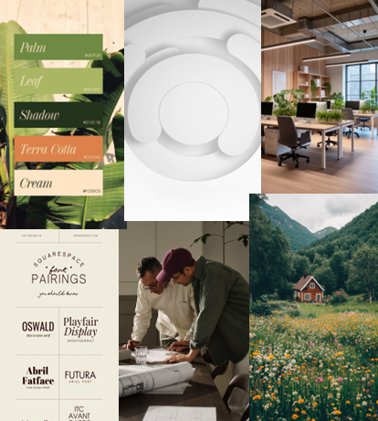
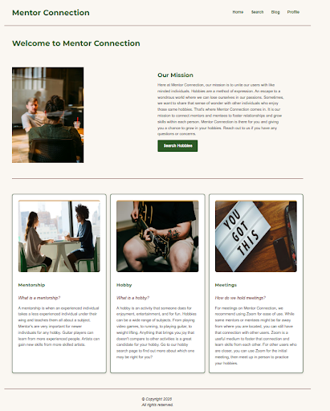
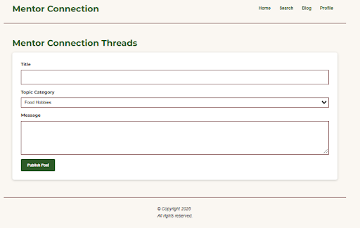
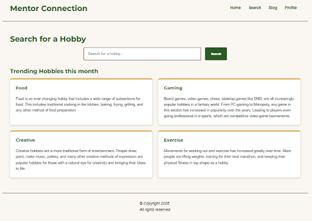

# Project Title: Using a website to bridge connections for hobbyists looking for community (work in progress)

## Objective
Many hobbyists struggle to improve their skills or stay motivated in their practice. Finding communities for their respective hobby can be difficult. The objective is to design a website that bridges this gap between experienced hobbyists and beginners.

## Synopsis
Mentor Connection is a community platform for everyday enthusiasts looking to learn and practice their hobbies. Existing platforms like superprof.com and findamentor.com focus on paid tutoring, academics, or career coaching. Mentor Connection is focused on giving casual learners a place to find experienced individuals to build skills and connections with. 

## Process
At the moment, Mentor Connection is still a work in progress. The website’s HTML content, CSS styles, and color scheme are already established. I began development by deciding on a visual direction through a mood board and wireframes. Next, I wrote the copy and implemented the styling. Moving forward, I will continue to refine the content and build out the JavaScript and backend.

## Results
The work is expected to be concluded by December 4th, 2026. I will update this case study with the completed version information. I will display the final product on my portfolio website. 

## Project Photos

### Planning Process
| Moodboard | Wireframe |
| --- | --- |
|   |  |

### Website Screenshots
| Working Page Designs | Not Finalized |
| --- | --- |
|  |  |
|  |  |

<a href="/README.md">Back to Readme</a>

