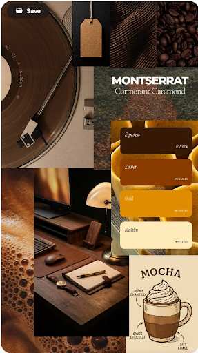
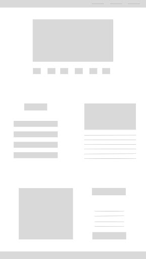
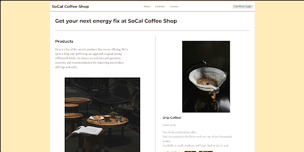
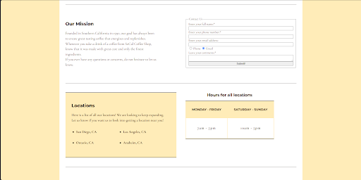
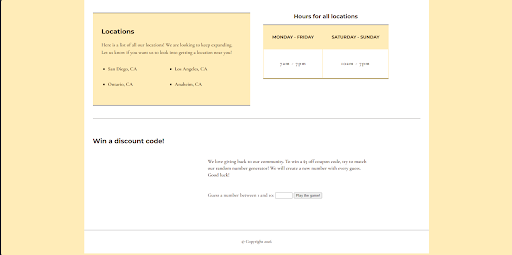
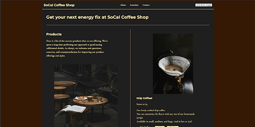
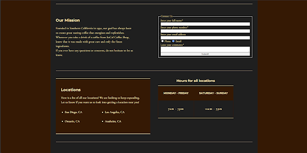
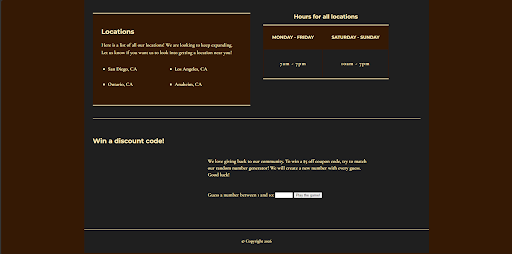

# Building a website presence for a local business

## Objective
I was tasked with creating a website platform for a local coffee shop that needed a digital presence to boost business and exposure. Because I frequent local coffee shops, I always check a business’s online presence to view menus and pricing when I am not physically there. Giving this shop an online presence will help them gain a stronger following.

## Synopsis
This work is similar to other local coffee shops in my area. A specific shop right around the corner from my house inspired my content, and I referenced their online branding and website content as a guide.

## Process
I began by reviewing local coffee shops near me for color scheme and branding inspiration. I created the mood board to focus on the right attributes for the website. Then, I built the wireframes for the landing page in Figma. Once the visual direction and layout were established, I began building the HTML framework and CSS, utilizing modern CSS methods and variables to maximize style efficiency. Finally, I created the JavaScript for a product display, contact form validation, and a guessing game where users can win a shop coupon. 
## Results
Once the work was finished, SoCal Coffee Shop had an interactive landing page for customers to browse. This work is viewable in my portfolio.

## Project Photos

### Planning Process
| Moodboard | Wireframe |
| --- | --- |
|   |  |

### Final Designs
- Light Mode

- Dark Mode

