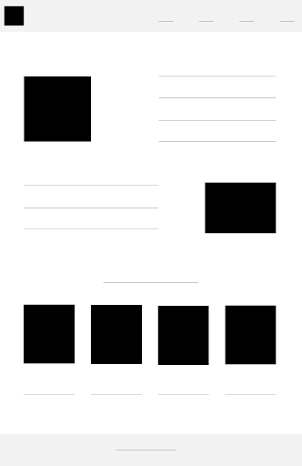
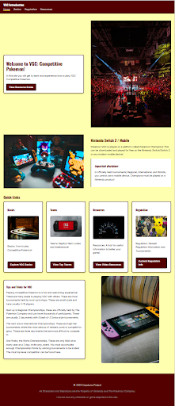
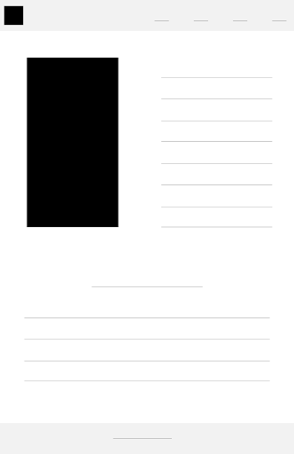
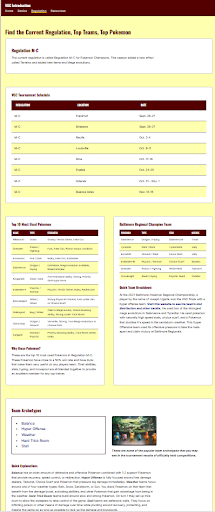
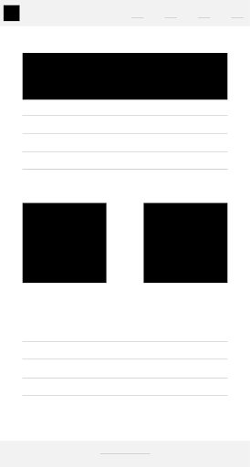
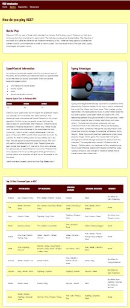
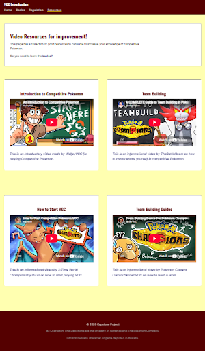

# Project Title: Modernizing Competitive Pokémon Resources with VGC Introduction

## Objective
The objective of this was to design an informational website about the rules of Competitive Pokémon and create a modern resource for players to utilize.

## Synopsis
VGC Guide is a commonly sourced reference and resource for established players. While this website is detailed and offers baseline information, it is also outdated in some respects. It has not been updated in the 6 years since it was created. VGC Introduction is simplified but still provides useful content for the user.

## Process
To begin development, I identified the best way to showcase the information by creating content wireframes. I planned out my reusable components like card styles and grids. I wrote the HTML using semantic structure. I filled out the content using tables, cards, and a heading hierarchy to guide the user's eye when interacting with the website. I declared a @layer order for my CSS to reduce precedence issues. I added options to print the webpage and enable dark mode.

## Results
I finished the project before the deadline. It resulted in a site that gives a basic introduction to playing Pokémon VGC, with written content, external resources, and an easily accessible webpage. My portfolio displays the work for viewing.

## Project Photos

| Wireframes | Final Designs |
| --- | --- |
|   |  |
|   |  |
|   |  |
|  |  |

<a href="/README.md">Back to Readme</a>
