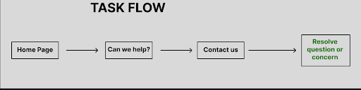
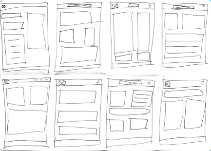
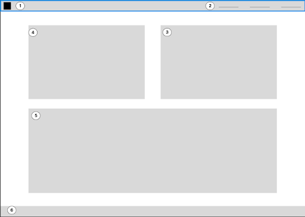
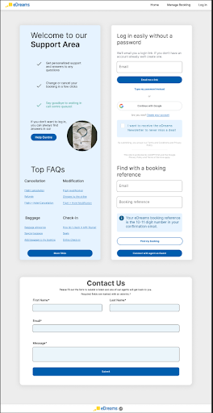

## Project Title
**Reformatting the future of the eDreams website (UX Design)**

## Background
eDreams is a global travel agency. It services international travel markets with flights and vacation packages.

## Problem Statement
They tasked me with redesigning their user interface based on research. They had reviews and complaints about their current model and needed a change. 

## Process
I reached out to several potential users with travel experience to test the current website. I gave them specific tasks targeting problem areas based on user research. After they completed the tasks, I compiled the results and updated the most problematic feature.

## Results
The reformatted webpage eliminated visual clutter and confusing user task flow. 

## Project Photos

### Planning Process
| Task Flow | Wireframes |
| --- | --- | --- |
|   |  |   |

### Final Mock Up
